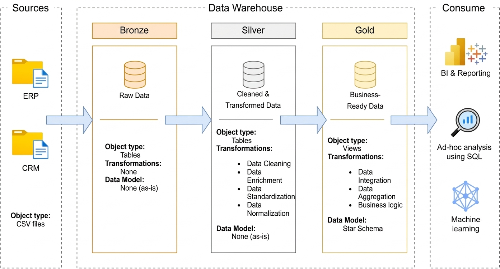
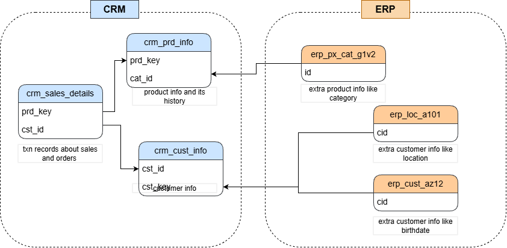
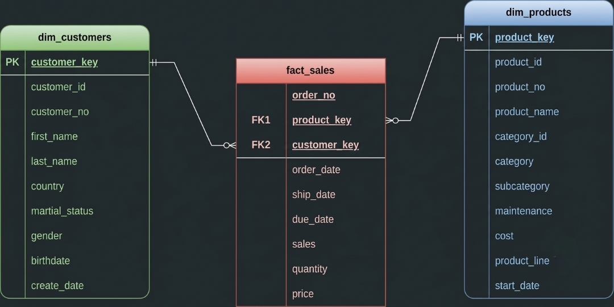

# End-to-End SQL Data Warehouse

An end-to-end data warehousing and analytics project built using **PostgreSQL and SQL**, integrating CRM and ERP data through ELT pipelines and Medallion Architecture to deliver business-ready data for analysis.

## 🏗️ Data Architecture

The project follows the **Medallion Architecture**, consisting of Bronze, Silver, and Gold layers.



- **Bronze Layer:** Loads raw CRM and ERP CSV files into PostgreSQL as-is.
- **Silver Layer:** Cleans, standardizes, and transforms data to improve consistency and reliability.
- **Gold Layer:** Integrates data into fact and dimension views using a Star Schema for analytical queries.

## 📂 Data Sources

The project uses six CSV files from two source systems: CRM and ERP.

| Source | Table | Description |
|---|---|---|
| CRM | `crm_cust_info` | Customer information |
| CRM | `crm_prd_info` | Product information and historical records |
| CRM | `crm_sales_details` | Sales transaction records |
| ERP | `erp_cust_az12` | Additional customer information, including birthdates |
| ERP | `erp_loc_a101` | Customer location information |
| ERP | `erp_px_cat_g1v2` | Product category information |

The sales dataset contains **60,000+ rows**, while some customer tables contain **18,000+ rows**.

## 🔗 Data Integration Model

CRM and ERP tables are integrated using shared business keys to consolidate sales, product, customer, category, and location information.



## 🔄 ELT Pipeline

1. **Extract and Load:** Load source CSV files into PostgreSQL Bronze-layer tables.
2. **Transform:** Clean and standardize data in the Silver layer using SQL.
3. **Integrate:** Combine related CRM and ERP tables.
4. **Model:** Create Gold-layer fact and dimension views following a Star Schema.
5. **Analyze:** Query the Gold layer to identify business trends and performance insights.

## ⭐ Gold-Layer Data Model

The Gold layer organizes integrated data into fact and dimension views, enabling analytical queries across customers, products, and sales.



## 📊 Exploratory Data Analysis

Performed SQL-based exploratory data analysis (EDA) on Gold-layer views using the Star Schema.

- **Database Exploration:** Examined database objects, tables, and views.
- **Dimension Exploration:** Analyzed customer and product attributes.
- **Measures and Business Metrics:** Evaluated key sales metrics.
- **Date Exploration:** Investigated sales trends and time-based patterns.
- **Magnitude Analysis:** Compared metrics across customers and products.
- **Ranking Analysis:** Identified top-performing customers and products using SQL ranking techniques.

The analysis helps uncover customer behavior, product performance, and sales trends.

## ✅ Data Quality

SQL validation scripts are included to check data quality in the Bronze and Gold layers, helping identify inconsistencies and improve the reliability of analytical results.

## 🛠️ Tech Stack

- **Database:** PostgreSQL
- **Query Language:** SQL
- **Data Pipeline:** ELT
- **Architecture:** Medallion Architecture (Bronze, Silver, Gold)
- **Data Modeling:** Fact and Dimension Views, Star Schema
- **Analytics:** SQL-based Exploratory Data Analysis

## 📁 Repository Structure

```text
data-warehouse-project/
├── datasets/
│   ├── src_crm/
│   └── src_erp/
├── docs/
│   ├── data_catalog.md
│   ├── data_integration_model.png
│   ├── data_model.png
│   └── dwh_architecture.png
├── sql_scripts/
│   ├── bronze/
│   │   ├── ddl_bronze.sql
│   │   └── load_bronze.sql
│   ├── silver/
│   │   └── load_silver.sql
│   ├── gold/
│   │   └── ddl_gold.sql
│   └── eda.sql
├── tests/
│   ├── quality_check_bronze.sql
│   └── quality_check_gold.sql
└── README.md
